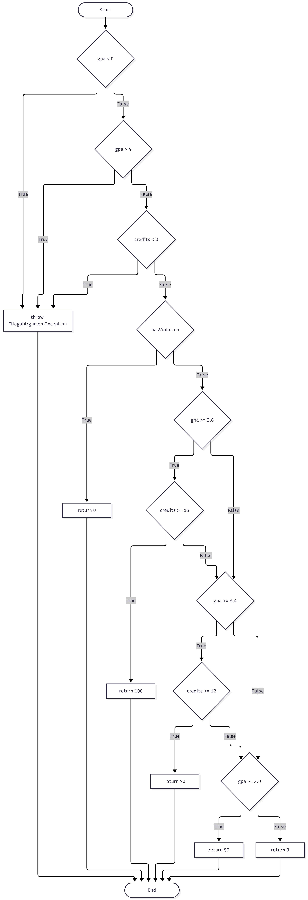

# Lab 09: Код хамралт (JaCoCo)

Оюутан: М.Наранбат  
Код: B242270801

## Орчны хувилбарууд

### java -version

```
<!-- JAVA_VERSION_OUTPUT -->
```

### mvn -version

```
<!-- MAVEN_VERSION_OUTPUT -->
```

## A. Анхны хамралт

Happy path-ийн 5 тест бичээд `mvn verify` ажиллуулсан (`results/mvn-verify-A.txt`). `results/jacoco-A.csv`-ээс Branch хамралт 51% (BRANCH_COVERED = 21, BRANCH_MISSED = 20), Line хамралт 60% (LINE_COVERED = 15, LINE_MISSED = 10) байв.

Тайлан дээр шар ромбо нь тухайн нөхцөлийн нэг салаа ажилласан ч нөгөө салаа нь дутуу байгааг харуулж байлаа. Улаан мөрүүд нь огт ажиллаагүй код, голдуу оролтын алдааны зам болон зарим үсгэн дүнгийн замууд байв. Иймээс зөвхөн хэвийн урсгалын тестүүдээр бүх нөхцөлийг шалгаж чадахгүй нь харагдсан.

## B. CFG ба 100% branch хамралт

`scholarship()` функцын CFG-г `cfg.png` файлд оруулав.



CFG-ийн ирмэгүүдэд тестийн методын нэрсийг тэмдэглэсэн. A хэсгийн 5 тест дээр нэмээд бүх салаа, нөхцөлийн үнэн/худал утга болон exception замуудыг шалгах тестүүд нэмсэн. B хэсгийн тайланд `results/mvn-verify-B.txt`-ийн дагуу нийт **21 тест** ажиллаж, алдаагүй дууссан. `results/jacoco-B.csv` файлд BRANCH_MISSED = 0, LINE_MISSED = 0 байна.

## C. Давталтын заагийн тестүүд

`gpa()` дахь давталтад 0 / 1 / 2+ дүрмийг шалгасан. 0 удааг `gpa_loop0_nullThrows` болон `gpa_loop0_emptyThrows` (хоёул `assertThrows` ашиглана), 1 удааг `gpa_loop1_singleScore_is4_0`, 2+ удааг `gpa_loop2plus_manyScores_is2_5` тестүүд тус тус шалгана.

Эдгээр тестүүд хамралтын хувийг нэмээгүй, учир нь кодын бүх мөр ба салаа өмнөх тестүүдээр аль хэдийн ажилласан байсан. Гэхдээ давталт огт ажиллахгүй, нэг удаа ажиллах, олон удаа ажиллах үед гарах алдааг зөвхөн хамралтын хувиар илрүүлэх боломжгүй. Тиймээс давталтын заагийн тест нь 100% хамралттай байсан ч шаардлагатай.

## D. Хамралт 100% — гэхдээ алдаа амьд

Зааг утгын 7 тест нэмээд `mvn test` ажиллуулахад `letterGrade_boundary60_isD` тест унасан. `results/mvn-test-D-fail.txt` файлд **expected: <D> but was: <F>** гэж бүртгэгдсэн. Шалтгаан нь `letterGrade()` методод `score > 60` гэж шалгасан байсан; харин спецификацийн дагуу 60 оноо D байх ёстой. Үүнийг `score >= 60` болгон зассан. Засварын дараах тусдаа commit: **Fix letterGrade boundary: 60 belongs to D**.

Засварын дараа цэвэр орчинд `mvn clean verify` дахин ажиллуулж, эцсийн гаралт болон JaCoCo CSV тайланг `results/mvn-verify-final.txt`, `results/jacoco-final.csv` файлд хадгалсан. Эцсийн тайланд 30 тест бүгд амжилттай ажиллаж, BRANCH_MISSED = 0, LINE_MISSED = 0 байх ёстой.

### Гол дүгнэлт

Branch хамралт 100% байсан ч заагийн алдаа үлдэж болдог. Branch хамралт нь нөхцөл бүрийн үнэн болон худал салаа ажилласан эсэхийг хэмждэг болохоос тухайн нөхцөлийн харьцуулах оператор спецификацитай зөв таарч байгаа эсэхийг хэмждэггүй. `score > 60` болон `score >= 60` нь ижил хоёр салаатай тул 65 ба 50 гэсэн тестүүд хоёуланг нь хамруулж чадна. Харин яг 60 гэсэн заагийн тест л хоёр хувилбарын ялгааг илрүүлсэн. Иймээс хамралт нь тестийн хүрээг хэмжих ч програмын зөв байдлыг дангаараа батлахгүй. Хамралтын тестүүдийг зааг утгын тестүүдтэй хамтад нь ашиглах шаардлагатай.

## AI-ийн ашиглалт

ChatGPT-г лабораторийн шаардлагыг шалгах, тестийн хамрах хүрээг нягтлах, README болон GitHub Actions-ийн баталгаажуулалтын ажлын урсгалыг боловсруулахад ашигласан. Эцсийн Java код, тест, JaCoCo тайлан болон Maven гаралтыг репозиторийн GitHub Actions орчинд дахин шалгаж баталгаажуулсан.
