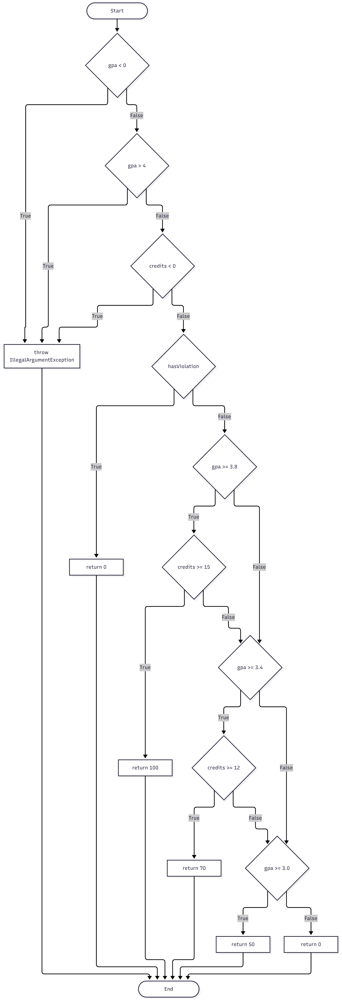

# Lab 09: Код хамралт (JaCoCo)

Оюутан: М.Наранбат

Код: B242270801

## java -version

```
## A. Анхны хамралт

Happy path-ийн 5 тест бичээд `mvn verify` ажиллуулсан (results/mvn-verify-A.txt). results/jacoco-A.csv-ээс: Branch хамралт 51% (BRANCH_COVERED 21, BRANCH_MISSED 20), Line хамралт 60% (LINE_COVERED 15, LINE_MISSED 10).

Тайлан дээр шар ромботой мөрүүд нь `if` нөхцөлд зөвхөн нэг тал нь (үнэн эсвэл худал) ажилласан газар байв: жишээ нь `letterGrade()` метод доторх GPA-ийн зааг нөхцөлүүд болон `scholarship()` доторх голч дүнг 3.5 ба 3.8-тай харьцуулах нөхцөлт шалгалтууд. Улаан мөрүүд нь огт ажиллаагүй хэсэг, голдуу алдааны замууд (throw) болон C, D, F дүнгийн салаанууд байлаа.

```

## mvn -version

```
## B. CFG ба 100% branch хамралт

scholarship() функцын CFG-г гараар зурсан:



Ирмэг бүрийн хажууд түүнийг дайрах тестийн нэрийг бичсэн. A-ийн тестүүд зөвхөн цөөн ирмэг хамарсан тул үлдсэн ирмэгүүдэд шинэ тест нэмсэн. Нийт XX тест шаардагдсан (results/mvn-verify-B.txt: Tests run: XX). results/jacoco-B.csv-д BRANCH_MISSED = 0, LINE_MISSED = 0 болсон.

```